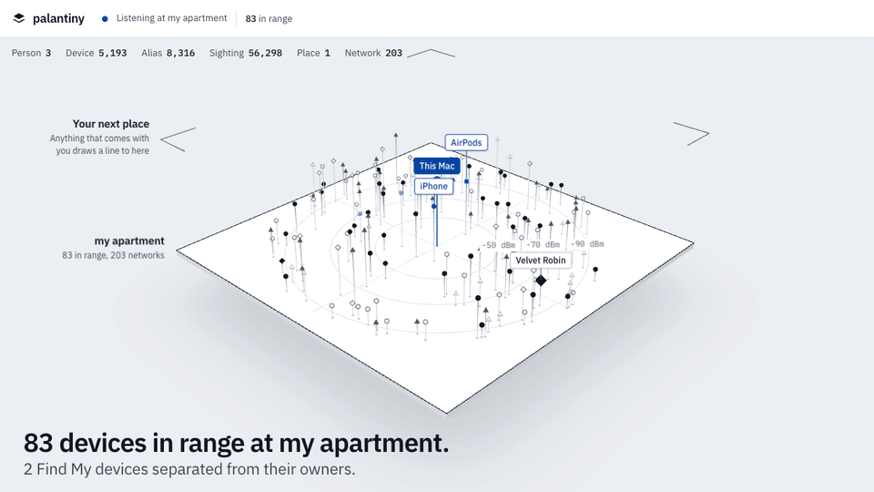
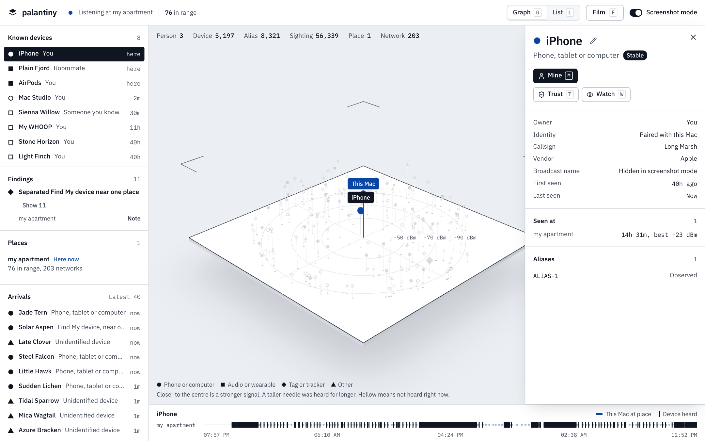
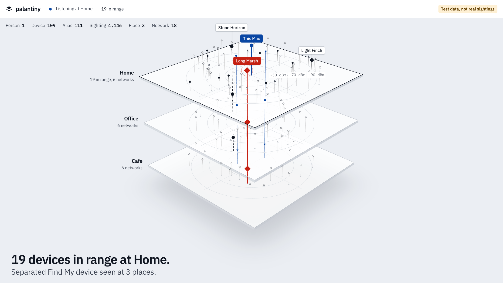

# palantiny

**Is anything following you? Your Mac can already hear the answer.**

palantiny listens to the Bluetooth and Wi-Fi broadcasts around your Mac, builds a small ontology of devices, people and places, and shows you what keeps turning up wherever you go. It runs entirely on your machine, with no accounts, no cloud and nothing to host.



> **Status:** the sensor, the ontology and the console work on real data. Detecting a device across two real places hasn't been proven yet, so read [what it can and can't follow](#what-it-can-and-cant-follow) before trusting it. This is a side project, not a safety tool, and it has no connection to Palantir Technologies.

## What you get

- **A live map of what's around you.** Every device stands on a needle: closer to the centre means a stronger signal, and taller means heard for longer.
- **Places without GPS.** Each place is recognised from its Wi-Fi fingerprint, and no coordinates are stored.
- **Following detection.** The same device at two of your places draws a line through both plates.
- **Find My awareness.** It spots Apple Find My devices that have been separated from their owners.
- **Callsigns, not serial numbers.** Strangers become `Copper Heron` or `Quiet Harbor`, and never a real identity.
- **Your own map of who owns what.** Claim your devices, name them, and tag people you know.
- **Alerts.** Watch a device and get a macOS notification if it turns up somewhere new.
- **Safe to record.** Screenshot mode strips names on the server, so they can't reach your screen recording.

## Try it

You need macOS 14 or later, [Bun](https://bun.sh) and the Xcode command line tools (`xcode-select --install`).

```sh
git clone https://github.com/narasim-teja/palantiny.git
cd palantiny
bun install
bun run dev
```

Open <http://127.0.0.1:4117>. macOS asks for two permissions for **palantiny sensor**:

| Permission | Why |
|---|---|
| Bluetooth | To hear nearby broadcasts |
| Location | macOS hides Wi-Fi names without it. palantiny stores no coordinates |

Your first place appears about a minute later, after two Wi-Fi scans agree.

**Just want to look around?** This loads labelled test data, with no permissions needed:

```sh
bun run fixture
bun run build
PALANTINY_DB=data/fixture.db PALANTINY_SENSOR=off bun run server
```

## Your first ten minutes

1. **Name your place.** Hover it under **Places** and press Rename.
2. **Claim your devices.** Anything paired with your Mac is already yours. For anything else, select it and press `M`, then type a name.
3. **Find a gadget.** Press `/` and search for `whoop`, `tv` or `samsung`. Turn off Screenshot mode to search by broadcast name too.
4. **Tag someone you know.** With Screenshot mode off, select their device and press **Add person**. They get a real name, plus a public name that's the only thing recordings show.
5. **Watch something.** Select a device and press `W`.
6. **Take your Mac somewhere.** Keep the lid open, stay at least 3 minutes, and a second plate appears.



## What it can and can't follow

Phones change their Bluetooth identity on purpose, and no log can undo that. So palantiny labels every device with whether it can be recognised again.

| Label | Means | Examples from real data | Follows between places? |
|---|---|---|---|
| **Stable** | One identity for 2+ hours, or paired with your Mac | WHOOP bands, earbuds, TVs, your own devices | Yes |
| **Named** | Rotates, but keeps a serial in its name | A Galaxy Watch | Yes, when it broadcasts that name |
| **Keyed** | A separated Find My device | Find My devices away from their owners | Same day. Keys [rotate about every 24 hours](https://datatracker.ietf.org/doc/html/draft-ietf-dult-accessory-protocol-00) |
| **Rotating** | Changes identity | Most phones, computers and unnamed headphones | No |
| **New** | Too soon to tell | Anything just heard | Not yet known |

So a line between plates means something, but **no line doesn't prove nothing followed you**. In one 38-hour run, 88% of identities lasted under 15 minutes.

This is what a device at three places looks like. It's labelled test data, because that view hasn't been captured from real life yet.



## Reading the results

- **Quote "in range", not the Device total.** The total keeps growing, because rotated addresses and passers-by each add a row. In range held at about 60 to 100 in one apartment while the total passed 5,000.
- **Your own devices show up first.** They go everywhere you go, so claim them.
- **A separated Find My device isn't proof of anything.** It could be a neighbour's keys, or someone you're with.
- **Dashed lines are guesses.** Linking rotating addresses is inference, and each link shows its confidence and evidence.

**If you think you're being tracked, use your phone's built-in tracker alerts and contact the police.** Don't rely on this.

## Trust and Watch

| | Trust | Watch |
|---|---|---|
| Means | I know this device | I want to know about this device |
| Findings | Never raises one | Raises one at a new place, or when it's back after 2+ hours away |
| Notifications | None | Yes |

Absence only counts while your Mac was listening, so closing the lid doesn't look like a device leaving. High findings notify you too. Watch can't hold on to something that rotates, and it warns you when that's the case.

## Privacy

palantiny only listens. It never connects to a device, and it doesn't capture packets.

- Everything stays in `data/` on your Mac, and the server only accepts connections from your own machine.
- Screenshot mode is on at every page load. Broadcast names and real names are removed on the server, and search can't find them either.
- Wi-Fi router addresses are stored only as salted hashes.
- Strangers' sightings are deleted after 30 days.
- The sensor stops when the server stops, so nothing keeps scanning in the background.

`data/` holds nearby devices' names, so never share it. The people around you didn't opt in: keep strangers pseudonymous, tell anyone you tag, and don't use this to follow anyone.

## How it works

```text
native/macos  ->  Unix socket  ->  server/         ->  HTTP + SSE  ->  web/
 (listens)        (JSON lines)     Bun + Hono          (/v1)          Vite + React
                                   SQLite, core/                      three.js
```

| Folder | Holds |
|---|---|
| `native/macos/` | The Swift sensor, using CoreBluetooth and CoreWLAN |
| `server/` | One Bun process that owns SQLite, reads sensors and serves the API |
| `core/` | The ontology, parsing and inference, in pure TypeScript |
| `web/` | The console |
| `scripts/` | The dev runner and test data |

The model is `Person -OWNS-> Device -HAS_ALIAS-> Alias`, with Devices and Networks `SEEN_AT` a Place through Sightings. An alias is what you hear on the air, and a device is a claim that several aliases are one thing, which keeps every guess visible.

**Read [How it works](HOW_IT_WORKS.md)** for how places, Find My parsing and alias linking work, what we measured, and the research behind it.

## Build on it

palantiny has two seams, so you can replace either end.

- **Write a sensor.** Anything that writes JSON lines to the socket is a sensor, in any language and on any OS. A Raspberry Pi would keep listening all night.
- **Write a client.** The web console only uses the local `/v1` API, so a native Mac app can do everything it does.

The [sensor format and API](HOW_IT_WORKS.md#plugging-in) are documented. A phone client would need authentication first, which doesn't exist yet.

## Reference

| Command | Does |
|---|---|
| `bun run dev` | Sensor, server and console, with hot reload |
| `bun run build && bun run start` | The same on one port, serving the built console |
| `bun run fixture` | Builds labelled test data in `data/fixture.db` |
| `bun test` | Runs the tests |
| `bun run typecheck` | Type checks everything |

| Key | Does |
|---|---|
| `G` / `L` | Graph or list |
| `/` | Search |
| `F` | Film mode, for clean recordings |
| `Esc` | Clear the selection |
| `M` / `N` | Claim, name |
| `T` / `W` | Trust, watch |

| Variable | Default | Does |
|---|---|---|
| `PALANTINY_DB` | `data/palantiny.db` | Which database to use |
| `PALANTINY_PORT` | `4117` | Server port |
| `PALANTINY_SENSOR` | `macos` on a Mac, otherwise `external` | `macos` launches the app, `external` waits for your own sensor, `off` runs without one |
| `PALANTINY_SOCKET` | `data/sensor.sock` | Where sensors connect |

## Troubleshooting

| Problem | Fix |
|---|---|
| No permission prompts | Allow **palantiny sensor** under System Settings, Privacy & Security |
| No place after a few minutes | Check that Wi-Fi is on and Location is allowed. Places need nearby networks |
| "Sensor offline" | `bun run dev` isn't running, or the sensor stopped |
| Gaps in the timeline | The Mac was asleep. Scanning mostly stops with the lid closed |
| No notifications | Check notification settings for Script Editor, which macOS shows as the sender |

## License

[MIT](LICENSE)
